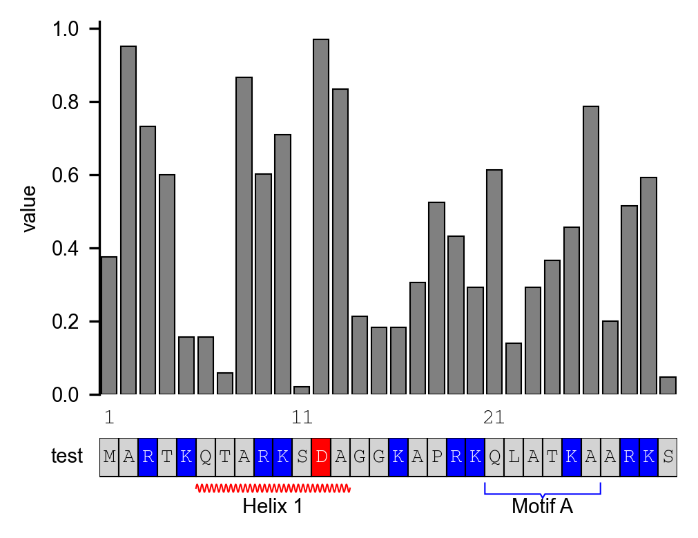

## Overview

This directory contains essential scripts used to generate, process, and analyze data for this project. Each script is documented individually with example commands and parameter explanations.

> **Note:**
> Example file paths provided in the usage examples are **for reference only**. Please adjust them according to your own filesystem structure.

If you encounter any issues while running these scripts or have questions beyond the scope of the provided documentation, please reach out via **[e-mail](mailto:jiangzj6@mail2.sysu.edu.cn)** or open an **[issue on GitHub](https://github.com/JuseTiZ/RDHGs_mutation_analysis/issues)**.

- [associate\_run.py](#associate_runpy)
- [calculate\_1-3-mer\_mt.py](#calculate_1-3-mer_mtpy)
- [calcu\_transcript\_feature.py](#calcu_transcript_featurepy)
- [demography\_perturb\_opt.py](#demography_perturb_optpy)
- [DFE\_cache.py](#dfe_cachepy)
- [get\_4dsite.py](#get_4dsitepy)
- [plot\_structure.py](#plot_structurepy)

### associate_run.py

This script performs genetic association analysis for both binary and continuous traits based on a given DataFrame (e.g., UK Biobank-derived datasets). It supports logistic regression for binary phenotypes and ordinary least squares (OLS) regression for quantitative traits. It was inspired by and partially references the [PheTK framework](https://github.com/nhgritctran/PheTK).

**Example usage:**

```
# For binary traits
python association_run.py \
    -i ukb.RDH_burden.white_british_no_relationship.csv \
    --covariates age age_square sex pc1 pc2 pc3 pc4 pc5 pc6 pc7 pc8 pc9 pc10 \
    --var_of_interest missense pLoF synonymous \
    -p "DD" "Child DD" "Adult DD" "have child" "Mental Health" "F70-89" "F80-89" "spontaneous" "infertility" "Male infertility" "Female infertility" \
    --sex None None None None None None None 1 None 0 1 \
    -o ukb.RDH_burden.WBnR.aggregate_mutation_association.binary.tsv
# For continuous traits
python association_run.py \
    -i ukb.RDH_burden.white_british_no_relationship.csv \
    --covariates age age_square sex pc1 pc2 pc3 pc4 pc5 pc6 pc7 pc8 pc9 pc10 \
    --var_of_interest missense pLoF synonymous \
    -p "Fluid intelligence" "Reaction time" "Time taken on pairs matching test" "Numeric memory" "Reaction time (IN)" "Numeric memory (IN)" "Number of live births" "Number of children fathered" \
    --sex None None None None None None 1 0 \
    --OLS \
    -o ukb.RDH_burden.WBnR.aggregate_mutation_association.continu.tsv
```

**Parameters:**

- `-i`: Input CSV file containing phenotype, covariates, and variant carrying status.
- `--covariates`: Covariate columns used to control confounding factors.
- `--var_of_interest`: Variables (e.g., burden counts) to be tested for association.
- `-p`: Phenotypes (traits) to be analyzed.
- `--sex`: *Optional* restriction per phenotype. None for both sexes. The numeric meaning must match your dataset’s sex encoding scheme.
- `-o`: Output TSV file for storing results.
- `--OLS`: Use linear regression for continuous traits.

For complete parameter details, run: `python association_run.py -h`

### calculate_1-3-mer_mt.py

This script calculates mutation spectra (1-mer and 3-mer contexts) for genomic regions defined in BED files. It analyzes variant data from VCF files and computes mutation counts while considering sequence context and strand information.

**Example usage:**

```
python calculate_1-3-mer_mt.py \
    --genome hg38.fa \
    --max_af 0.0001 \
    --bed human.repli-dep-histone_transcript.4dsite.no_transcript_conflict.filter_bl.bed \
    --name repli-dep-histone_transcript_af1e-4 \
    --contain_strand \
    --output_path result/mutation_asymmetry_info/4dsite/human \
    --vcf gnomadv4.all_snv.vcf.gz
```

**Parameters:**

- `--genome`: Path to the reference genome FASTA file. Chromosome naming must match the VCF and BED files.
- `--max_af`: Maximum allele frequency threshold. Variants with AF higher than this are masked.
- `--bed`: One or more BED files containing genomic regions of interest.
- `--name`: Custom names for output files, corresponding to the BED files. If omitted, the script will automatically use each BED file's basename.
- `--contain_strand`: *Optional*. If set, read the strand column (4th) from BED file and count strand-specific mutations.
- `--output_path`: Output directory for result files. Default is the current directory (`.`).
- `--vcf`: Input VCF file (bgzipped and indexed) containing SNV data.

For complete parameter details, run: `python calculate_1-3-mer_mt.py -h`


### calcu_transcript_feature.py

This script calculates transcript-level features from BigWig files for annotated genomic regions. It extracts quantitative values (e.g., conservation scores, variant density) from BigWig tracks across transcript features defined in GTF annotation files.

**Example usage:**

```
python calcu_transcript_feature.py \
    --gtffile gencode.v44.basic.annotation.Ensembl_canonical.autosomes.gtf \
    --bigwig \
    hg38.phyloP100way.bw \
    hg38.phastCons100way.bw \
    gerp_conservation_scores.homo_sapiens.GRCh38.bw \
    --bigwigname \
    phyloP100way \
    phastCons100way \
    GERP \
    --include_genetype protein_coding --include_region exon \
    --output human.gencodeV44.pc_canonical.exon_conservation_score.tsv
```

**Parameters:**

- `--gtffile`: Path to the GTF file used for transcript annotation.
- `--bigwig`: One or more BigWig files from which per-base values will be extracted.
- `--bigwigname`: Corresponding names for the BigWig files (**must match in number with --bigwig**).
- `--include_genetype`: List of gene types (from the GTF attribute gene_type or gene_biotype) to include in the analysis, e.g., protein_coding.
- `--include_region`: GTF region types to include in calculations. Typical choices: `exon`, `CDS`, or `transcript`.
- `--output`: Path to the output file containing per-transcript feature statistics.

For complete parameter details, run: `python calcu_transcript_feature.py -h`

### demography_perturb_opt.py

This script fits one-dimensional demographic models to a synonymous site-frequency spectrum (SFS) using the [δaδi](https://github.com/RyanGutenkunst/dadi) (dadi) framework. It supports bottleneck–plateau–growth (BPG), two-epoch and constant-size models. Provide an existing projected SFS or generate one from a VCF or dadi data dictionary.

**Example usage:**

1. **Use VCF Input**
```
python demography_perturb_opt.py \
    -v hg38.1kg_superanc_EUR.unrelated_493indivi.gencodeV44ensemblCano_CDS.synonymous_snv.vcf.gz \
    --popinfo 1KGenome.unrelated.EUR.txt \
    -s 42 --popid EUR --ns 900 --fold_fs \
    -o result/1kg_unrelated_EUR/1KGenome.unrelated.EUR
```

2. **Use Pre-computed dadi Data Dictionary**
```
python demography_perturb_opt.py \
    --data_dict result/gnomad_nfe/gnomadv4.all_snv.only_nfe.synonymous.bpkl \
    -s 42 --popid NFE --ns 2000 --fold_fs \
    -o result/gnomad_nfe/gnomadv4.nfe
```

3. **Use a Projected Synonymous SFS**
```bash
python demography_perturb_opt.py \
    --fs result/gnomad_nfe/gnomadv4.nfe.samplesize_2000.fold.fs \
    --model two_epoch --seed 42 --starts 100 \
    -o result/gnomad_nfe/gnomadv4.nfe
```

4. **Parallel Optimization with Slurm**
```
#!/bin/bash
#SBATCH -J gnomad1ddemo
#SBATCH -w node80
#SBATCH --array=1-100%48
#SBATCH --ntasks=1
#SBATCH -o logs/gnomad1ddemo_%A_%a.out
#SBATCH -e logs/gnomad1ddemo_%A_%a.err

seed=${SLURM_ARRAY_TASK_ID}
python demography_perturb_opt.py \
    --data_dict result/gnomad_nfe/gnomadv4.all_snv.only_nfe.synonymous.bpkl \
    -s "$seed" --popid NFE --ns 2000 --fold_fs \
    -o result/gnomad_nfe/gnomadv4.nfe
```

**Parameters:**

- `--fs` — Path to an existing one-dimensional projected synonymous SFS. The sample size and folding status are read from the file.
- `-v` — Input VCF of synonymous SNVs with genotype information.
- `--popinfo` — Sample-to-population assignments for the VCF, in dadi's population information format.
- `--data_dict` — Precomputed dadi data dictionary (`.bpkl`). When generating a spectrum, this takes priority over `-v`.
- `--popid` — Population ID used to generate the SFS.
- `--ns` — Sample size for projection when generating the SFS.
- `--fold_fs` — Fold the SFS when generating it from a VCF or data dictionary.
- `--model` — `bpg` (default), `two_epoch` or `constant`.
- `-s` or `--seed` — First random seed for perturbing initial parameters. The default is 42.
- `--starts` — Number of optimisation starts using consecutive seeds. The default is one. The BPG and two-epoch analyses used 100 starts with seeds 42–141. The constant-size model is evaluated once per invocation.
- `-o` or `--out` — Output prefix for the generated spectrum and demographic results.

Each valid start appends a row with `#ll_model`, the model parameters and `theta0` to a tab-separated result file. For BPG the filename is `PREFIX.samplesize_N.fold.1d_demo_fits.result`. The two-epoch and constant-size filenames insert `.two_epoch` or `.constant` immediately before `.1d_demo_fits.result`. Unfolded spectra use `unfold` in the filename.

For complete parameter details, run: `python demography_perturb_opt.py -h`

### DFE_cache.py

This script uses the fitted demographic parameters and projected sample size to precompute one-dimensional SFSs under selection with dadi's `Cache1D`. The cache uses 300 logarithmically spaced points spanning scaled deleterious selection-coefficient magnitudes from 0.0001 to 7,500.

**Example usage:**

```bash
python DFE_cache.py \
    --fs result/gnomad_nfe/gnomadv4.nfe.samplesize_2000.fold.fs \
    --opt_result result/gnomad_nfe/gnomadv4.nfe.samplesize_2000.fold.1d_demo_fits.result \
    --model bpg --cpu 32
```

**Parameters:**

- `--fs` — Path to the projected one-dimensional spectrum (`.fs`).
- `--name` — Alternative to `--fs`. Use a prefix that identifies a single `.fs` file.
- `--opt_result` — A demographic `.result` table or `demography.json`. For a table, the script selects the row with the highest `#ll_model` among rows with finite values in the required columns. For JSON, it uses the stored parameters from a valid fit.
- `--model` — Model used to fit the demographic parameters. Choose `bpg` (default), `two_epoch` or `constant`.
- `--cpu` — Number of CPUs for cache generation. The default is 32.
- `-o` or `--out` — Optional output cache filename. By default, the script appends `_1d_cache.bpkl` to the BPG input spectrum filename, or `_two_epoch_1d_cache.bpkl` or `_constant_1d_cache.bpkl` for the corresponding model.

For complete parameter details, run: `python DFE_cache.py -h`

### get_4dsite.py

This script identifies four-fold degenerate (4D) sites based on a given GTF annotation and genome FASTA file.

If a genomic position is four-fold degenerate in one transcript but not in another, the position will be excluded (conflict sites are removed).

**Example usage:**

```
python get_4dsite.py \
    --gtffile gencode.v44.basic.annotation.Ensembl_canonical.autosomes.gtf \
    --genome hg38.fa \
    --valid_pc gencode.v44.pc_translations.fa.gz \
    --output_pep \
    --output human.gencodeV44.basic.absolute_4dsite.bed
```

**Parameters:**

- `--gtffile`: Path to the GTF file used for transcript annotation.
- `--genome`: Path to the genome FASTA file (must match chromosome naming convention with the GTF).
- `--valid_pc`: *Optional FASTA file of validated protein-coding sequences*. If provided, each reconstructed CDS will be translated and compared to the sequence in this file. Transcripts with mismatched translations will be skipped.
- `--output_pep`: *Optional*. If set, output reconstructed CDS and translated protein sequences to FASTA files.
- `--output`: Output file path for 4D site coordinates (in BED format).

For complete parameter details, run: `python get_4dsite.py -h`

### plot_structure.py

This script provides a set of visualization utilities for protein structure and sequence annotation, integrating both secondary structure parsing (via DSSP and mmCIF files) and highly customizable peptide/sequence plotting using Matplotlib. It was inspired by and partially references the [seqplot](https://github.com/intbio/seqplot).

| Main function                      | Purpose                                                                                                                      |
| ----------------------------- | ---------------------------------------------------------------------------------------------------------------------------- |
| `get_structure()`             | Extracts helix and sheet intervals from mmCIF files using DSSP, automatically recognizing histone families (H1–H4).          |
| `plot_peptide_sequence()`     | Generates a customizable peptide sequence diagram with annotations, color-coded residue properties, and optional bar graphs. |
| `merge_intervals()`           | Utility to merge consecutive residue indices into interval ranges.                                                           |

**Example Usage:**

```
from plot_structure import plot_peptide_sequence
import matplotlib.pyplot as plt
import numpy as np

sequence = "MARTKQTARKSDAGGKAPRKQLATKAARKS"
annotations = [
    {"label": "Helix 1", "range": (5, 12), "style": "helix", "color": "red"},
    {"label": "Motif A", "range": (20, 25), "style": "brace", "color": "blue"},
]

np.random.seed(42)
values = np.random.rand(len(sequence))

plt.figure(figsize=(5, 2))

fig, _, _ = plot_peptide_sequence(
    seq=sequence,
    seq_label="test",
    annotations=annotations,
    values=values,
    bar_label="value",
    height_ratios=[6, 1],
)

fig.savefig("plot_structure.png", dpi=300, bbox_inches="tight")
```

<p align="center">
  
</p>

For advanced usage, see `figures/Fig3/fig3_c.ipynb`